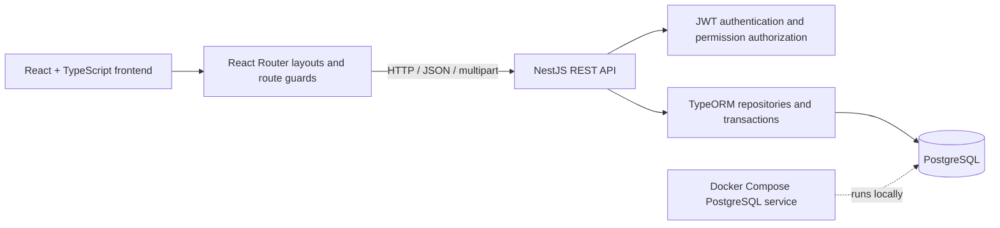
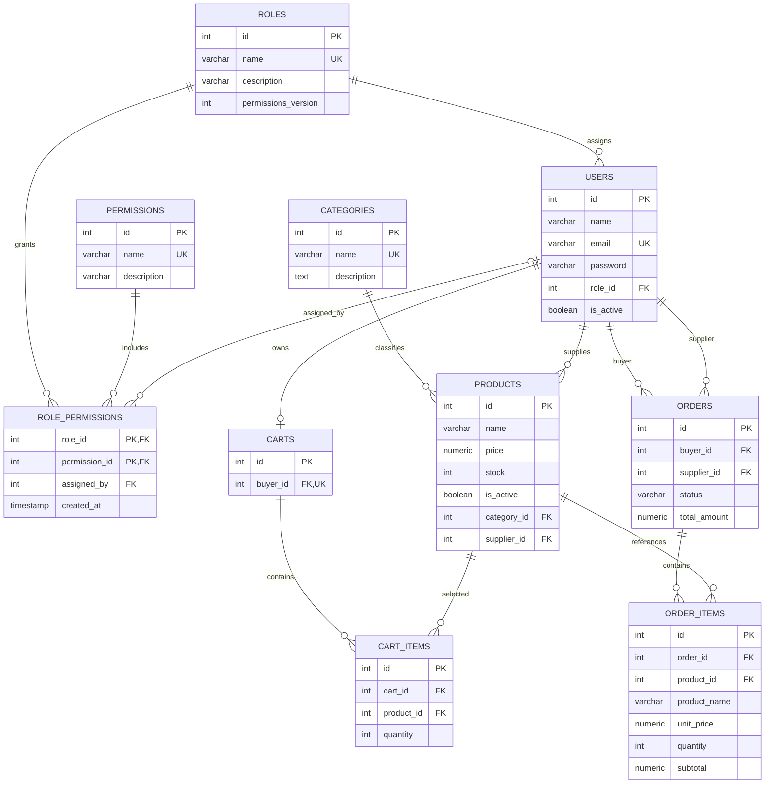

# Watermelon Marketplace

A B2B marketplace application with a React storefront and role-specific workspaces backed by a NestJS REST API and PostgreSQL. Buyers can browse products, maintain a persistent cart, and check out. Suppliers manage their product catalog and supplier orders. Administrators manage supplier accounts, categories, permissions, and role-permission assignments.

> This repository is an in-progress assessment project. The README describes the behavior present in the current source; it does not imply payment processing, general user administration, or admin-wide order management.

## Contents

- [Project overview](#1-project-overview)
- [Technology stack](#2-technology-stack)
- [Architecture and project structure](#3-architecture-and-project-structure)
- [Backend architecture](#4-backend-architecture)
- [Database design](#5-database-design)
- [Authentication and authorization](#6-authentication-and-authorization)
- [Main business workflows](#7-main-business-workflows)
- [Frontend architecture and user experience](#8-frontend-architecture-and-user-experience)
- [Key technical decisions and trade-offs](#9-key-technical-decisions-and-trade-offs)
- [AI usage and development workflow](#10-ai-usage-and-development-workflow)
- [Challenges and trade-offs](#11-challenges-and-trade-offs)
- [Prerequisites](#12-prerequisites)
- [Installation and setup](#13-installation-and-setup)
- [Available scripts](#14-available-scripts)
- [API overview](#15-api-overview)
- [Known limitations and future improvements](#16-known-limitations-and-future-improvements)

## 1. Project Overview

Watermelon Marketplace is a B2B marketplace where buyers source products from suppliers. The application has three account roles:

- **Buyer** — browses active products, uses a persistent cart, checks out, and views their own orders.
- **Supplier** — manages their products and images, and views and completes their own orders.
- **Admin** — creates and manages supplier accounts, manages categories, and manages permissions and role assignments.

Checkout can turn one buyer cart into several supplier-specific orders. The backend is responsible for stock and price validation, creating those orders atomically, and retaining product name and price snapshots for order history.

There is no payment gateway. “Checkout” in this implementation means order creation and stock decrement, not payment capture or fulfillment.

## 2. Technology Stack

Versions below are the dependency ranges declared in the package manifests, not a claim about a particular installed lockfile resolution.

**Backend**

- NestJS `^12.0.1`, TypeScript `^6.0.2`
- PostgreSQL 16 for the Docker Compose development database
- TypeORM `^1.1.3` and `pg ^8.23.1`
- JWT with Passport (`@nestjs/jwt`, `@nestjs/passport`, `passport-jwt`)
- `bcrypt ^6.0.0` for password hashing
- `class-validator` and `class-transformer` for request validation and transformation

**Frontend**

- React and React DOM `^19.3.1`, TypeScript `~6.0.3`
- Vite `^8.3.6`
- Tailwind CSS `^4.3.3` with `@tailwindcss/vite`
- React Router `^8.4.0`
- Axios for REST requests
- React Hook Form and Zod for form state and validation
- ApexCharts for dashboard charts
- React Helmet Async for page metadata

**Development tools**

- Docker Compose for local PostgreSQL
- npm scripts, Nest CLI, TypeORM CLI, Oxlint, and ESLint
- Postman can be used to exercise the HTTP API; DBeaver or another PostgreSQL client is optional
- Git

The frontend dependency manifest requires Node.js `>=22.12.0`. Use a compatible Node.js installation for both projects.

## 3. Architecture and Project Structure

The frontend is a single-page React application. It communicates with the NestJS REST API through a shared Axios client. The API uses TypeORM to access PostgreSQL; the browser does not connect to the database directly. Docker Compose supplies the local PostgreSQL service.



Simplified repository structure:

```text
.
├── backend/
│   ├── src/
│   │   ├── auth/              # JWT, registration, login, profile, password change
│   │   ├── authorization/     # Permission context, decorator, and guard
│   │   ├── cart/              # Persistent buyer carts
│   │   ├── categories/        # Marketplace category API and service
│   │   ├── database/          # TypeORM DataSource, migrations, seeders
│   │   ├── orders/            # Checkout, buyer history, supplier order APIs
│   │   ├── permissions/       # Permission management
│   │   ├── products/          # Catalog, supplier product management, image storage
│   │   ├── roles/             # Roles and role-permission synchronization
│   │   ├── suppliers/         # Admin supplier account management
│   │   └── users/             # User entity and TypeORM module
│   └── test/                  # NestJS end-to-end starter test
├── frontend/
│   └── src/
│       ├── api/               # Shared Axios client
│       ├── components/        # TailAdmin and shared UI components
│       ├── features/          # Auth, catalog, cart, orders, and dashboard features
│       ├── layouts/           # Marketplace and dashboard layouts
│       ├── pages/marketplace/ # Marketplace landing page
│       └── routes/            # Central route configuration
└── docker-compose.yml         # Local PostgreSQL 16 service
```

## 4. Backend Architecture

NestJS modules group controllers, services, and TypeORM entities by feature. Controllers translate HTTP requests into service calls; services implement business rules; DTOs validate request payloads; entities describe database mappings and relationships. JWT and permission guards attach and enforce authenticated authorization context.

| Module | Responsibility |
|---|---|
| `auth` | Buyer registration, login, JWT strategy, profile, and password change |
| `authorization` | Loads a user's current role permissions and enforces `@Permissions(...)` metadata |
| `users` | Exposes the User entity through TypeORM for other modules; it has no general users controller |
| `roles` | Lists roles, reads permissions, and synchronizes assignments transactionally |
| `permissions` | Permission listing and description/name creation/deletion rules |
| `suppliers` | Admin-facing supplier account creation, listing, editing, activation, and deactivation |
| `categories` | Public category listing and protected category management |
| `products` | Public active catalog, supplier inventory, product mutations, and local image storage |
| `cart` | Buyer-owned persistent cart operations and availability calculations |
| `orders` | Single-request checkout, buyer order history, supplier order dashboard, and status transition |
| `database` | TypeORM DataSource, migrations, and explicit seed command |

The global `ValidationPipe` transforms DTO values, removes no unknown fields silently (`whitelist: true`), and rejects non-whitelisted fields (`forbidNonWhitelisted: true`). CORS origins and the application port are configured in `main.ts`. Product uploads are served statically from `/uploads/products`.

`synchronize` is set to `false` in both application and CLI TypeORM configuration. Schema changes are applied through migrations rather than automatic synchronization. The API does not configure Swagger/OpenAPI in the current source.

## 5. Database Design

The schema is represented by TypeORM entities and five migrations under `backend/src/database/migrations/`. Foreign keys, unique constraints, check constraints, and indexes protect core relationships and invariants in the database as well as in application code.

| Table | Purpose and notable constraints |
|---|---|
| `roles` | Unique role name, optional description, and `permissions_version` counter. |
| `permissions` | Unique permission name and optional description. |
| `role_permissions` | Composite primary key `(role_id, permission_id)`. `assigned_by` is nullable and references the assigning user; role/permission deletion cascades assignment rows, while deleting the assigner sets the reference to null. |
| `users` | Buyer, supplier, and admin accounts. Unique email, role foreign key with delete restricted, active flag, and password column excluded from ordinary TypeORM selection. A role index supports role-based lookups. |
| `categories` | Unique category name, optional description, and timestamps. |
| `products` | Supplier-owned catalog item, category foreign key, `numeric(12,2)` price, stock, optional image URL, active flag, and timestamps. Price must be positive, stock non-negative; category/supplier deletion is restricted. Indexes cover category and supplier. |
| `carts` | One cart per buyer, enforced by a unique buyer foreign key. |
| `cart_items` | Cart/product pair is unique; quantity must be positive. Cart deletion cascades; product deletion is restricted. Indexes cover cart and product. |
| `orders` | Buyer and supplier foreign keys, `numeric(12,2)` total, status constrained to `pending` or `completed`, and timestamps. Indexes cover buyer and supplier. |
| `order_items` | Belongs to an order and references a product. Stores product name, unit-price, quantity, and subtotal snapshots. Quantity and monetary values must be positive. Order deletion cascades; product deletion is restricted. |

The schema is initialized and extended by these committed migrations:

1. `CreateIdentityTables` — users, roles, permissions, role assignments.
2. `CreateProductCatalog` — categories and products.
3. `CreateShoppingAndOrders` — carts, cart items, orders, order items.
4. `AddPermissionsVersionToRoles` — permission version counter.
5. `AddActiveStatusToUsers` — account activation flag.

The `role_permissions` join is an explicit entity because assignments carry `assigned_by` and `created_at` metadata. Monetary amounts use PostgreSQL `numeric` so values are stored as exact decimal values rather than binary floating-point. Order items retain name and price snapshots so a later product edit does not rewrite history.

TypeORM also maintains its migration-history table (named `migrations` by the current CLI configuration); it is operational metadata rather than a marketplace domain entity.



## 6. Authentication and Authorization

### Authentication

- `POST /auth/register` creates a buyer account only. It looks up the seeded buyer role, hashes the password with bcrypt (cost factor 12), and returns a JWT and safe user information. The request has no role field.
- `POST /auth/login` verifies email and bcrypt password and returns a signed token. Invalid credentials use a generic message.
- JWTs are signed with `JWT_SECRET` and expire according to `JWT_EXPIRES_IN`. The token carries `sub`, name, email, and role identity. `JwtStrategy` validates the bearer token and rejects expired tokens.
- Protected requests load the active user's current role and permissions from PostgreSQL. `JwtAuthGuard` attaches the authorization context and exposes its `permissionsVersion` in `X-Permissions-Version`.
- `GET /auth/profile` returns the authenticated profile and authorization information. `POST /auth/change-password` verifies the current password, rejects a same-password change, and stores a bcrypt hash in a transaction.
- The frontend stores the access token in `localStorage`, adds it as a bearer token through the shared Axios client, and refreshes profile state. A 401 response clears the stored token and notifies the auth provider.

Authentication establishes the caller's identity; authorization determines whether that caller may perform an action. Backend route guards and service-level role/ownership checks are authoritative. Frontend route guards and navigation improve the user experience but are not security boundaries.

### Permission model

The seed data defines roles and permissions independently, then assigns permissions through `role_permissions`. `JwtAuthGuard` authenticates and loads current permissions. `PermissionsGuard` checks the route metadata supplied by `@Permissions(...)`. Some services additionally enforce a role and resource ownership—for example, supplier products and supplier orders are filtered by the authenticated supplier's ID.

The seeded role matrix is:

| Capability | Buyer | Supplier | Admin |
|---|:---:|:---:|:---:|
| `products.view` | ✓ | ✓ | ✓ |
| `products.create`, `products.update`, `products.delete` | — | ✓ | ✓ |
| `cart.manage` | ✓ | — | ✓* |
| `orders.create`, `orders.view_own` | ✓ | — | ✓* |
| `orders.view_supplier`, `orders.update_status` | — | ✓ | ✓* |
| `suppliers.create`, `suppliers.view`, `suppliers.update`, `suppliers.activate`, `suppliers.deactivate` | — | — | ✓ |
| `categories.view`, `categories.create`, `categories.update`, `categories.delete`, `categories.manage` | — | — | ✓ |
| `permissions.view`, `permissions.create`, `permissions.update`, `permissions.delete` | — | — | ✓ |
| `roles.view`, `roles.assign_permissions` | — | — | ✓ |
| `users.manage` | — | — | ✓ |

`*` Admin assignments exist in seed data, but buyer cart/order service methods require the buyer role. Supplier status updates require supplier ownership; the service also permits an admin with `orders.update_status` to update any order. The broad `users.manage` and `categories.manage` permissions are seeded, but current APIs use dedicated supplier/category permissions and there is no general users controller.

The role synchronization endpoint accepts the full permission ID set in one request, validates IDs, updates assignments in a transaction, and increments `permissions_version` when assignments change. It prevents removing the admin role's required permission-management permissions.

### Seeded permissions

`products.view`, `products.create`, `products.update`, `products.delete`, `cart.manage`, `orders.create`, `orders.view_own`, `orders.view_supplier`, `orders.update_status`, `users.manage`, `suppliers.create`, `suppliers.view`, `suppliers.update`, `suppliers.activate`, `suppliers.deactivate`, `categories.manage`, `categories.view`, `categories.create`, `categories.update`, `categories.delete`, `permissions.view`, `permissions.create`, `permissions.update`, `permissions.delete`, `roles.view`, and `roles.assign_permissions`.

## 7. Main Business Workflows

### 7.1 Product Management

Suppliers use `/products/my` and `/products/my/:id` to access their own inventory. Mutations receive an authorization context; the service uses the authenticated supplier ID and checks ownership before edits or deletes. Admins may create or manage products when their permissions allow it; admin creation must specify a valid active supplier. Suppliers cannot submit a different `supplierId`.

The public catalog and product details endpoints return active products. Listing supports pagination, name search, category, supplier and price filters, plus sorting by price, name, or creation time. Supplier inventory also supports active-status filtering.

Product creation and update accept multipart `image` fields. The API allows JPEG, PNG, and WebP up to 5 MB and verifies the image signature against the declared MIME type. Filenames are generated as UUIDs. Files are saved under `backend/uploads/products/` and served at `/uploads/products/<filename>`. That upload directory is ignored by Git. Product creation also accepts a DTO `imageUrl` when no file is uploaded. Local filesystem storage is suitable for development but is ephemeral on some deployment platforms and is not shared across multiple API instances; persistent or object storage is a future deployment concern.

### 7.2 Shopping Cart

Each buyer has one persistent `carts` row and cart lines in `cart_items`. The cart is initialized on access, and the unique buyer and cart/product constraints prevent duplicate carts or lines. Adding and changing quantities checks the current active state and available stock; the returned cart includes current product price, subtotal, and availability. Cart operations use database transactions and lock the buyer's cart row.

Adding an item does not reserve stock or decrement inventory. Stock is rechecked and decremented only during checkout, so another buyer can purchase the same stock first. A cart may then show inactive or insufficient-stock items and checkout can reject it.

### 7.3 Checkout and Supplier-Based Order Splitting

One `POST /orders/checkout` request processes the buyer's whole cart. The service:

1. Opens one database transaction and locks the buyer's cart row.
2. Loads the cart lines and locks the corresponding products in ID order.
3. Rejects missing or inactive products and insufficient stock.
4. Reads prices from the database and computes monetary amounts in integer cents using `BigInt`; it does not trust client-submitted prices or totals.
5. Groups lines by `supplier_id` and creates a separate pending order plus its order items for each supplier.
6. Saves product-name and unit-price snapshots on each order item.
7. Decrements product stock and removes all cart lines.
8. Commits all changes together when the callback succeeds.

Because order creation, stock updates, and cart clearing share one transaction, a failure for one supplier rolls back the entire checkout. For example:

```text
Cart: Product A (Supplier X), Product B (Supplier X), Product C (Supplier Y)

Checkout result:
  Order 1 — Supplier X — Products A and B
  Order 2 — Supplier Y — Product C

Both orders commit together, or neither order is left behind.
```

Pessimistic row locks reduce concurrent overselling while checkout validates and decrements stock. There is no payment authorization/capture stage, and no payment or refund API is implemented.

### 7.4 Order Management

Checkout creates one order per supplier. Buyers list and view only their own orders using `GET /orders` and `GET /orders/:id`. Suppliers list and view only orders where their authenticated account is the supplier using `/supplier/orders` routes. Ownership is included in database queries, so an order belonging to another buyer/supplier is not disclosed.

Both views use historical `order_items.productName`, `unitPrice`, `quantity`, and `subtotal`, not current product values. The only statuses are `pending` and `completed`; a supplier may transition their own order from pending to completed. The service uses a pessimistic lock during status change. An admin with the status permission may update any order. Reverting completed orders, cancellation, refunds, and payment processing are not implemented.

### 7.5 Administration

The admin workspace contains supplier account listing/search/pagination, supplier creation/editing/activation, category management, permission management, role listing and role-permission synchronization, and an overview dashboard. Supplier creation is admin-only and hashes the initial password. Admin accounts are created by the explicit seed command.

There is no general user-management endpoint, admin-wide order feed, or admin product management page/API. The overview marks statistics unavailable when the existing APIs cannot provide them rather than fabricating totals.

## 8. Frontend Architecture and User Experience

The frontend is one Vite application with a distinct `MarketplaceLayout` for public/buyer storefront routes and an `AppLayout` for TailAdmin-style admin and supplier dashboards. `AppRoutes.tsx` centrally declares routes for marketplace home, product catalog/details, buyer cart/checkout/order history, password changes, admin pages, and supplier pages.

Authentication is held in an `AuthProvider`; role route guards redirect guests to login and route authenticated users to their role's home. The shared Axios client attaches bearer tokens and handles unauthorized responses. Each feature has API functions, types, pages, and reusable components. Forms use React Hook Form and Zod where implemented. Pages include loading, empty, and error states where appropriate.

The current app does **not** use TanStack Query or another dedicated server-state cache. Feature pages request data through API functions and React hooks/state. Marketplace browsing is public; buyer-only cart, checkout, and order-history routes require a buyer session. Backend guards and ownership checks remain authoritative.

## 9. Key Technical Decisions and Trade-offs

| Decision | Reason and trade-off |
|---|---|
| NestJS modules and services | Organize API responsibilities by feature and keep controllers focused on HTTP. The trade-off is some cross-feature coordination in services, especially the growing order workflow. |
| PostgreSQL | Provides relational constraints, transactions, row locks, and exact `numeric` amounts needed for stock and order consistency. It requires a running database service during development. |
| TypeORM migrations | Schema changes are explicit, reviewable, and repeatable across environments. Developers must run migrations as a separate setup/deployment step. `synchronize` stays disabled. |
| Docker Compose for local PostgreSQL | Gives contributors a repeatable PostgreSQL 16 service with a health check and persistent named volume without a native database installation. The password in Compose is development-only and must not be reused in deployed environments. |
| JWT bearer authentication | Fits a browser client and REST API without server-side session storage. Tokens expire, and protected requests reload current account/permission context; the frontend currently stores the bearer token in localStorage, which is exposed to script execution if an XSS vulnerability exists. |
| Permissions separate from roles | Routes declare capabilities; roles receive capability assignments. This allows role permissions to be synchronized independently, while service-level role and ownership checks still enforce domain rules. |
| Ownership checks in services/queries | A permission alone does not prove that a supplier owns a product or order. Queries scope resources to the authenticated identity to prevent cross-account access. |
| Database-persisted carts | Cart state survives browser sessions/devices and is available to transactional checkout. This adds database traffic and requires handling stock changes between cart edits and checkout. |
| Separate orders per supplier | Each supplier can manage their own portion of a buyer's multi-supplier purchase. Buyers see multiple order records from one checkout rather than one cross-supplier order. |
| One transaction per checkout | Prevents partial multi-supplier orders and keeps stock, orders, and cart clearing consistent. The transaction holds locks while checking and writing, so large carts can increase lock duration. |
| Order-item snapshots | Preserve historical names and prices when a supplier edits a product. Current product references remain for referential integrity and product deletion is restricted while history references it. |
| One React app, two layout families | Reuses API/auth infrastructure while keeping storefront presentation separate from the admin/supplier dashboard. The app still ships shared dependencies together; route-level code splitting is not currently configured. |

These are implementation trade-offs for the current scope, not claims of production readiness.

## 10. AI Usage and Development Workflow

OpenAI Codex was the primary AI development tool used during implementation. I worked with it feature by feature within the existing NestJS and React/TypeScript architecture rather than asking it to generate the whole application at once. Codex assisted with backend and frontend implementation, incremental refactoring, resolving integration issues, checking changes against requirements and acceptance criteria, and running available build, lint, and other development checks.

### Representative prompts

The examples below are **edited and shortened excerpts from actual feature requests**, provided for readability. They are not verbatim quotations of the full prompts.

**Backend**

- "Implement registration and login with JWT, buyer-only registration, and password hashing." (Edited excerpt of the authentication request.)
- "Implement permission-based authorization with a permissions guard and route decorator." (Edited excerpt of the permission authorization task.)
- "Implement product CRUD and enforce supplier ownership." (Edited excerpt of the product management task.)
- "Implement a persistent shopping cart using the existing architecture and database entities." (Edited excerpt of the cart task.)
- "Implement checkout with transactional stock management and split cart items into supplier orders." (Edited excerpt of the checkout task.)
- "Implement buyer order history and the supplier order dashboard using existing entities and authorization." (Edited excerpts of the buyer and supplier order tasks.)

**Frontend**

- "Implement the Buyer Marketplace Product Catalog with search, category filtering, and pagination." (Edited excerpt of the catalog task.)
- "Implement the Marketplace Product Details page using the existing frontend architecture and backend APIs." (Shortened excerpt of the product details task.)
- "Implement the Marketplace Shopping Cart using the existing frontend architecture and backend APIs." (Shortened excerpt of the cart task.)
- "Implement the Marketplace Checkout page, grouping cart items by supplier and handling all orders returned by checkout." (Edited excerpt of the checkout task.)
- "Implement Buyer Order History using the existing frontend architecture and backend APIs." (Shortened excerpt of the order history task.)
- "Return a JWT after buyer registration and establish frontend authentication immediately; preserve role-based navigation." (Edited excerpt combining the registration auto-login and authentication/navigation tasks.)

### Development workflow

The implementation followed an iterative workflow:

1. Understand the feature requirement.
2. Define its business rules and acceptance criteria.
3. Inspect the existing architecture and identify the relevant components and API contracts.
4. Ask Codex to implement a focused feature that fits those conventions.
5. Review the generated implementation and adjust it where needed.
6. Verify frontend/backend integration and exercise behavior where possible.
7. Run the available build, lint, and other development checks.
8. Commit completed features separately.

I remained responsible for defining requirements and business rules, making architectural and technical decisions, reviewing generated code, keeping backend and frontend behavior consistent, verifying application behavior, and identifying limitations and deciding how to address them. Codex assisted with implementation and review; it did not independently design the application, and I do not claim to have manually written every line of code.

## 11. Challenges and Trade-offs

- **Supplier data isolation:** General permissions do not establish ownership. Product and order services additionally scope reads and mutations to the authenticated supplier ID.
- **Multi-supplier checkout:** One cart can create multiple supplier orders. Grouping and writes happen inside one transaction so stock failure does not leave a partial set of orders.
- **Concurrent stock changes:** Checkout takes pessimistic row locks for the cart and products before verifying availability and decrementing stock. This reduces overselling but can hold database locks for the duration of the checkout transaction.
- **Historical data:** Order items store snapshots rather than relying on mutable product names/prices. Product foreign keys use delete restrictions, preserving references to purchased items.
- **Local image files:** UUID filenames and signature checks reduce filename/content risks, and the upload directory is Git-ignored. Local disk does not provide durable shared storage for ephemeral or horizontally scaled deployments.
- **API coverage:** The frontend dashboard cannot report administrator-wide buyer/order totals because those APIs do not exist. It displays unavailable states instead of estimating or using mock data.
- **Automated testing:** Backend Jest scripts and starter tests exist, but this repository does not contain feature-level automated test coverage. The frontend has no automated test runner configured.

## 12. Prerequisites

- Git
- Node.js `>=22.12.0` and npm
- Docker Desktop or Docker Engine with the Docker Compose plugin
- Optional: Postman for HTTP requests and DBeaver or another PostgreSQL client for database inspection

PostgreSQL does not need to be installed natively when using the provided Compose file.

## 13. Installation and Setup

### 1. Clone the repository

```bash
git clone https://github.com/zolfekar-seleten/basic-marketplace.git
cd basic-marketplace
```

### 2. Start PostgreSQL

```bash
docker compose up -d postgres
docker compose ps
docker compose exec postgres pg_isready -U postgres -d watermelon_market
```

The Compose service uses `postgres:16`, database `watermelon_market`, user `postgres`, and binds PostgreSQL to `127.0.0.1:5432`. Data persists in the `postgres_data` named volume. The password `watermelon_dev_password` in `docker-compose.yml` is a **local development-only credential**. Do not reuse it in production.

### 3. Configure backend environment

```bash
cd backend
cp .env.example .env
```

Edit `backend/.env` before starting the API or seeder. In particular, set `DB_PASSWORD=watermelon_dev_password` to match the local Compose database, and replace the JWT and initial admin examples with values you choose. The actual `.env` is ignored by Git.

| Variable | Purpose | Example/development value | Required |
|---|---|---|:---:|
| `APP_PORT` | NestJS HTTP port; code falls back to 3000 | `3000` | Optional |
| `NODE_ENV` | Development logging and CORS behavior | `development` | Optional; set explicitly for local work |
| `CORS_ORIGINS` | Comma-separated allowed origins outside development mode | `http://localhost:5173,http://127.0.0.1:5173` | Optional by config; set for production |
| `DB_HOST` | PostgreSQL hostname | `localhost` | Yes |
| `DB_PORT` | PostgreSQL port | `5432` | Yes |
| `DB_USERNAME` | Database user | `postgres` | Yes |
| `DB_PASSWORD` | Database password | `watermelon_dev_password` for local Compose only | Yes |
| `DB_DATABASE` | Database name | `watermelon_market` | Yes |
| `JWT_SECRET` | Secret used to sign and validate bearer tokens | Generate a long random local value | Yes |
| `JWT_EXPIRES_IN` | JWT lifetime accepted by the JWT library | `1h` | Yes |
| `ADMIN_NAME` | Initial admin display name for seeding | Choose a name | Required by `npm run seed` |
| `ADMIN_EMAIL` | Initial admin email; trimmed and lowercased by the seeder | Choose an email | Required by `npm run seed` |
| `ADMIN_PASSWORD` | Initial admin password; hashed by bcrypt | Choose a strong password (max 72 UTF-8 bytes) | Required by `npm run seed` |

The environment example's admin values are examples only. Choose your own credentials. The seeder does not print the password and does not reset the password for an existing admin account with the configured email.

### 4. Install backend dependencies

```bash
npm install
```

Run this command from `backend/`.

### 5. Run migrations and seed initial data

Still in `backend/`, apply migrations first, then seed:

```bash
npm run migration:run
npm run seed
```

Migrations create/update the schema. Seeding is a separate transaction and adds roles, permissions, an initial admin, role assignments, and the five initial categories. It is not run when the application starts. The seed requires all three `ADMIN_*` variables. It will refuse to convert a non-admin account or create a second admin with a different email. Existing configured admin credentials are not overwritten.

To inspect migration status, use `npm run migration:show`. To inspect the schema, connect a database client to `localhost:5432` and select `watermelon_market`.

### 6. Start the backend

```bash
npm run start:dev
```

The API listens at `http://localhost:3000` by default. No Swagger UI is configured.

### 7. Configure the frontend environment

In a second terminal:

```bash
cd frontend
cp .env.example .env
```

`VITE_API_URL` is the backend base URL and is required by the shared API client. Its example is `http://localhost:3000`. During Vite development, requests use the `/api` proxy and Vite forwards them to this target.

### 8. Install frontend dependencies

```bash
npm install
```

Run this command from `frontend/`.

### 9. Start the frontend

```bash
npm run dev
```

Vite prints the local URL, normally `http://localhost:5173`.

### 10. Verify the application

- PostgreSQL container reports healthy and `pg_isready` succeeds.
- Backend starts and connects using the configured database variables.
- Migrations have run and the seed command completed.
- The configured admin can log in; use the credentials you entered in your local `.env`.
- Buyer registration and login work.
- Product categories and active catalog listings load.
- A buyer can add products to the cart and place checkout orders.
- A supplier account created by an admin can access the supplier workspace and its own products/orders.
- An admin can access the admin dashboard and its supplier/category/role/permission pages.

## 14. Available Scripts

Run scripts from the corresponding `backend/` or `frontend/` directory.

### Backend

| Script | Purpose |
|---|---|
| `npm run start` | Start NestJS once |
| `npm run start:dev` | Watch-mode development server |
| `npm run start:debug` | Watch mode with Node inspector |
| `npm run build` | Compile with Nest CLI |
| `npm run start:prod` | Run `dist/main` after build |
| `npm run lint` | Run Oxlint with type-aware checking on source and tests |
| `npm run format` | Format backend TypeScript source and test files with Prettier |
| `npm run migration:create -- src/database/migrations/Name` | Create an empty TypeORM migration |
| `npm run migration:generate -- src/database/migrations/Name` | Generate a migration from entity/schema differences |
| `npm run migration:run` | Apply pending migrations |
| `npm run migration:revert` | Revert the latest migration |
| `npm run migration:show` | Show migration status |
| `npm run seed` | Run the explicit transactional database seed |
| `npm test` / `npm run test:e2e` | Run Jest unit or configured end-to-end test command |
| `npm run test:watch` / `npm run test:cov` | Watch tests or collect coverage |

There is also a Nest `deploy` script in `backend/package.json`; deployment configuration is not documented as a production-ready workflow here.

### Frontend

| Script | Purpose |
|---|---|
| `npm run dev` | Start Vite development server |
| `npm run build` | Run TypeScript project build and create production assets |
| `npm run preview` | Serve the production build locally for preview |
| `npm run lint` | Run Oxlint and ESLint |

## 15. API Overview

Base URL for local use: `http://localhost:3000`. Protected endpoints use `Authorization: Bearer <access-token>`. Permission names below refer to the seeded role-permission assignments; services may enforce additional role and ownership checks. Request validation is applied globally.

| Method | Path | Access | Purpose |
|---|---|---|---|
| `GET` | `/` | Public | Nest starter welcome response (`Hello World!`); not a readiness or health check |

### Authentication

| Method | Path | Access | Purpose |
|---|---|---|---|
| `POST` | `/auth/register` | Public; creates buyers only | Register and return token/user |
| `POST` | `/auth/login` | Public | Authenticate by email/password |
| `GET` | `/auth/profile` | JWT | Return authenticated profile and permissions |
| `POST` | `/auth/change-password` | JWT | Verify current password and store a new hash |

### Catalog and categories

| Method | Path | Access | Purpose |
|---|---|---|---|
| `GET` | `/products` | Public; active products only | Paginated product catalog. Query: `page`, `limit` (max 100), `search`, `categoryId`, `supplierId`, `minPrice`, `maxPrice`, `sortBy` (`price`, `name`, `createdAt`), `sortOrder` (`ASC`, `DESC`). |
| `GET` | `/products/:id` | Public; active products only | Product details |
| `POST` | `/products` | JWT + `products.create` | Create product; accepts multipart form and optional `image`. Supplier creates for self; admin specifies supplier. |
| `GET` | `/products/my` | JWT + `products.view`; supplier role | Supplier's paginated inventory; supports search/category/active filters and sorting |
| `GET` | `/products/my/:id` | JWT + `products.view`; supplier ownership | Supplier-owned product detail |
| `PATCH` | `/products/:id` | JWT + `products.update`; ownership/admin service rules | Update product fields and optional image |
| `DELETE` | `/products/:id` | JWT + `products.delete`; ownership/admin service rules | Delete product if no cart/order FK prevents it |
| `GET` | `/categories` | Public | List categories, including product counts |
| `GET` | `/categories/options` | JWT + `products.create` | Compact category options for product forms |
| `GET` | `/categories/:id` | JWT + `categories.view` | Category details and product count |
| `POST` | `/categories` | JWT + `categories.create` | Create category |
| `PATCH` | `/categories/:id` | JWT + `categories.update` | Update category name/description |
| `DELETE` | `/categories/:id` | JWT + `categories.delete` | Delete only when no products reference it |

Product list query DTOs also support `isActive` for authenticated supplier inventory. Public catalog responses are restricted to active products.

### Cart and orders

| Method | Path | Access | Purpose |
|---|---|---|---|
| `GET` | `/cart` | JWT + `cart.manage`; buyer role | Read/create the authenticated buyer's cart |
| `POST` | `/cart/items` | JWT + `cart.manage`; buyer role | Add quantity for a product (`productId`, `quantity`) |
| `PATCH` | `/cart/items/:id` | JWT + `cart.manage`; buyer owns cart item | Update quantity |
| `DELETE` | `/cart/items/:id` | JWT + `cart.manage`; buyer owns cart item | Remove one item |
| `DELETE` | `/cart` | JWT + `cart.manage`; buyer role | Clear all cart lines |
| `POST` | `/orders/checkout` | JWT + `orders.create`; buyer role | Create all supplier orders in one transaction; no client total/body is accepted |
| `GET` | `/orders` | JWT + `orders.view_own`; buyer role | Buyer order list. Query: `page`, `limit` (max 100), `status`, `sort` (`newest`/`oldest`). |
| `GET` | `/orders/:id` | JWT + `orders.view_own`; buyer ownership | Buyer order details |
| `GET` | `/supplier/orders` | JWT + `orders.view_supplier`; supplier role | Supplier's orders. Supports the same pagination/status/sort query. |
| `GET` | `/supplier/orders/:id` | JWT + `orders.view_supplier`; supplier ownership | Supplier order details |
| `PATCH` | `/supplier/orders/:id/status` | JWT + `orders.update_status`; supplier owns order, or authorized admin | Request `{ "status": "completed" }`; only pending-to-completed is allowed |

### Supplier administration

All routes require JWT and `PermissionsGuard`.

| Method | Path | Permission | Purpose |
|---|---|---|---|
| `POST` | `/suppliers` | `suppliers.create` | Create supplier account |
| `GET` | `/suppliers` | `suppliers.view` | Paginated/searchable supplier list. Query: `page`, `limit`, `search`, `isActive`. |
| `GET` | `/suppliers/:id` | `suppliers.view` | Supplier details |
| `PATCH` | `/suppliers/:id` | `suppliers.update` | Update supplier name/email |
| `PATCH` | `/suppliers/:id/activate` | `suppliers.activate` | Activate account |
| `PATCH` | `/suppliers/:id/deactivate` | `suppliers.deactivate` | Deactivate account |

### Permissions and roles

All routes require JWT and the specified permission.

| Method | Path | Permission | Purpose |
|---|---|---|---|
| `GET` | `/permissions` | `permissions.view` | List permissions |
| `GET` | `/permissions/:id` | `permissions.view` | Permission details |
| `POST` | `/permissions` | `permissions.create` | Create permission |
| `PATCH` | `/permissions/:id` | `permissions.update` | Update a permission description; name is immutable |
| `DELETE` | `/permissions/:id` | `permissions.delete` | Delete only when not assigned to a role |
| `GET` | `/roles` | `roles.view` | List roles |
| `GET` | `/roles/:id/permissions` | `roles.view` | Read role permissions and version |
| `PUT` | `/roles/:id/permissions` | `roles.assign_permissions` | Synchronize permission IDs transactionally; requires `permissionIds` in the request body |

There is no `/users` administration endpoint, general admin order endpoint, or Swagger endpoint in the current backend.

## 16. Known Limitations and Future Improvements

These items are not represented as completed features:

- Replace local product-image storage with durable object storage for production and multi-instance deployments.
- Add feature-level backend integration tests and frontend unit/component/end-to-end tests. Current backend test files are Nest starter tests; frontend has no test runner configured.
- Add admin-wide user statistics and user/order feeds if the dashboard requires them; those APIs are currently absent.
- Add payment gateway integration, payment/refund state, and related reconciliation before treating checkout as paid.
- Add production deployment configuration, secret management, migrations/seeding automation, and a persistent upload strategy.
- Consider rate limiting, structured observability, and email notifications as operational requirements are defined.
- Consider a dedicated server-state cache and route-level code splitting as the frontend grows.

